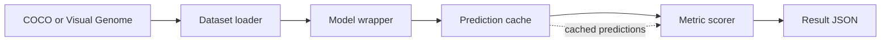

Mirage is an evaluation framework for studying object hallucination in vision-language models. It provides shared interfaces for datasets, model inference, prediction caching, and metric scoring so evaluation runs can be inspected and repeated.

The runnable entry point, `demo.py`, connects the supported COCO and Visual Genome dataset paths with model wrappers and evaluation metrics. Its prediction cache lets you score saved model outputs again without repeating inference. Each metric keeps its own protocol and assumptions, so results should be interpreted within the metric being used.

<CardGroup cols={2}>
  <Card title="Get started" icon="rocket" href="/getting-started">
    Install Mirage and run the one-image smoke test.
  </Card>
  <Card title="Datasets" icon="database" href="/datasets">
    Prepare COCO and Visual Genome inputs.
  </Card>
  <Card title="Run evaluations" icon="terminal" href="/running-evaluations">
    Choose a dataset, model, metric, and output path.
  </Card>
  <Card title="Metrics and models" icon="chart-column" href="/metrics-and-models">
    Review available model wrappers and scoring protocols.
  </Card>
  <Card title="Run on an HPC cluster" icon="server" href="/hpc">
    Prepare a GPU job and submit it with SLURM.
  </Card>
  <Card title="Maintain the docs" icon="book-open" href="/maintaining-docs">
    Preview changes and see what the automated checks cover.
  </Card>
</CardGroup>

## Evaluation data flow

Mirage keeps dataset handling, inference, and scoring as separate steps. The cache sits between inference and scoring so cached predictions can be rescored with a metric without generating the model output again.

## Reference model results

These reference results compare three model configurations across COCO and Visual Genome for four metrics. Higher is better for POPE accuracy, ROPE strict accuracy, and THRONE F1. Lower is better for CHAIR instance-level hallucination rate, labeled CHAIR-I (CHI). The chart includes measured configurations only. A newly integrated model needs evaluation results before it can appear here.

Each model and dataset result uses 1,000 images. ROPE strict accuracy requires an exact label match. THRONE F1 is normalized to 38 distractor categories per ground-truth object. The metrics measure different behaviors and should be compared within each panel, not combined into a single model ranking. The plotted values are available in the [model results data](https://github.com/Advanced-Vision-and-Learning-Lab/mirage/blob/main/docs/model-results.csv), and the chart can be regenerated with `python scripts/plot_model_results.py`.
