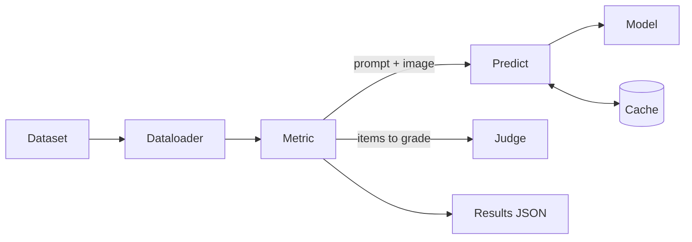

## Dataset and dataloader

A dataloader reads a dataset's annotation file and image folder and returns one sample per image: `image_id`, `image_path` and the list of object names in `categories`. Mirage ships loaders for COCO and Visual Genome in `dataloader/`. A new dataset needs a loader that returns the same fields.

## Labels

Metrics trust the dataset's labels, so a dataset that does not label every object needs extra work first. On Visual Genome, Mirage removes junk object names like "stillness" and "flloor", adds objects the judge saw in the image to each image's labels, and only averages THRONE over categories with at least 5 images. Expect to do similar cleanup for any dataset with sparse or free text labels.

## Metrics

Each metric builds its questions from the samples, asks the model through Predict, and returns a raw score and a judged score. See [Metrics](/metrics/overview).

## Predict and models

Predict sends each request to a model and saves every answer in a cache, so a repeated request never loads the model. See [Predict](/predict) and [Models](/models).

## Judge

The judged scores read stored verdicts from a stronger vision language model. See [Judge](/judge).
